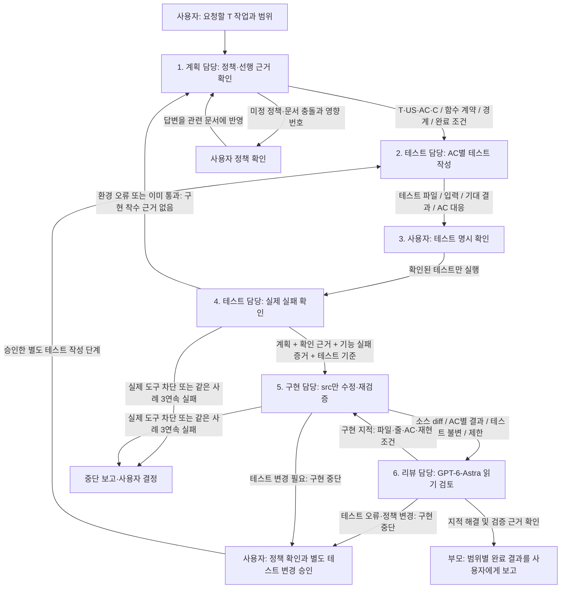

# 16장 실습 — 역할별 에이전트와 전달 순서

이번 요청은 네 역할의 에이전트 생성과 협업 흐름 문서화이다. 구체적인 기능 T 작업은 아직 배정하지 않았다. 아래 절차는 후속 기능 작업에 적용한다.

## 역할과 작업 경계

| 역할 | 에이전트 | 모델 | 책임과 허용 변경 | 전달하는 결과 |
|---|---|---|---|---|
| 계획 담당 | `/root/planner` | 부모 모델 상속 | 요청받은 범위의 계획·문서. 제품 정책은 사용자 답변 없이 결정하지 않음 | T·US·AC·C, 선행 완료 근거, 작업 순서, 공개 함수 계약, 경계 사례, 완료 조건 |
| 테스트 담당 | `/root/test_writer` | 부모 모델 상속 | 테스트만 작성: `tests/**` 및 그 안의 fixture. `src`·문서·설정 수정 금지 | AC별 테스트 파일·사례·입력·기대값, 사용자 확인 근거, 실제 실패 실행 결과 |
| 구현 담당 | `/root/implementer` | 부모 모델 상속 | `src/**`만 수정. 예약·결제 도메인 규칙은 `src/rules` 순수 함수에만 작성. 테스트·문서·설정 수정 금지 | 소스 diff, AC별 검증 명령·결과, 테스트 불변 근거, 남은 제한 |
| 리뷰 담당 | `/root/reviewer` | **GPT-6-Astra** (`gpt-6-astra`) | 읽기와 검토만. 어떤 파일도 수정하지 않음 | 근거가 있는 지적, 파일·줄·관련 AC, 재현 조건, 심각도, 검증 누락과 완료 판단 |

부모 에이전트(`/root`)는 전달·사용자 확인·실행 이력·최종 보고를 조율한다. 역할의 파일 경계는 작업 지시이며 별도 파일시스템 샌드박스를 추가한 것은 아니다. 네 에이전트는 같은 작업 폴더를 공유하며 다른 사람의 변경을 되돌리지 않는다.

모든 역할은 작업 전에 [PRD](prd.md), [수용 기준](acceptance.md), [작업 목록](tasks.md), [작업 지침](../AGENTS.md), [헌법](../.specify/memory/constitution.md)을 읽는다. [하네스 문서](harness.md)의 과거 기록과 현재 작업 지침이 다르면 현재 지침을 따른다.

## 전달 그래프

## 단계별 인계 규칙

1. **계획 → 테스트:** 요청받은 T의 선행 조건을 실제 증거로 확인한다. 확정된 AC의 이번 검증 부분과 미검증 부분을 구분한다. 조건부 AC와 미정 C에 대한 기대값은 만들지 않는다. 기술 구성이 미확정인 부분은 T-01·C-10 합의가 먼저다.
2. **테스트 → 사용자 → 실패 확인:** 작성된 파일과 AC 대응, 입력·기대값을 부모가 사용자에게 제시한다. 기능 구현 요청이나 문서 승인으로 테스트 확인을 대신하지 않는다. 명시 확인 후에만 실제 실행한다. 미구현·동작 불일치로 실패한 증거가 있어야 다음 단계로 간다. 환경 오류·미실행·skip·이미 통과한 테스트는 실패 관문을 충족하지 않는다.
3. **실패 확인 → 구현:** 사용자 확인 근거, 승인된 테스트의 diff 또는 해시, 실행 명령, 실패 파일·사례·AC·이유를 전달한다. 구현 담당은 승인된 테스트를 수정·삭제하거나 기대값을 완화하지 않는다. 테스트 통과를 숨기거나 만들기 위해 설정을 바꾸지 않는다.
4. **구현 → 리뷰:** 소스 diff와 검증 증거를 전달한다. 리뷰 담당은 계획·AC·테스트·구현을 대조하고 역할 경계, 순수 함수, 금액·시간·권한·중복 처리와 미검증 범위를 확인한다. 직접 수정하지 않고 지적을 구현 담당에게 돌려보낸다. 소스 수정 후에는 해당 검사를 다시 실행하고 리뷰를 다시 받는다.
5. **테스트 변경이 필요할 때:** 구현을 멈추고 관련 문서·US·AC·T·C, 테스트 파일·사례, 현재/제안 기대값, 이유·영향을 사용자에게 제시한다. 정책 답변과 별도 테스트 변경 승인 후 테스트 담당이 수정한다. 수정된 테스트는 다시 사용자 확인 → 실패 확인 → 구현 순서로 진행한다.
6. **완료 보고:** 부모가 변경 파일, 관련 번호, 실행 명령·결과, 남은 제한을 정리한다. AC별 `PASS / FAIL / BLOCKED / NOT_RUN`을 구분하고 정적 확인·모의 처리·브라우저·토스 테스트 실연결을 별도로 기록한다. 리뷰 통과만으로 실행하지 않은 기능을 PASS로 만들지 않는다.

## 중단과 실행 이력 공유

- `tests` 경로를 참조하는 셸 명령은 한 호출에 명령 하나씩 실행한다. 복합 명령 형식만 차단됐다면 같은 작업을 개별 호출로 나누어 재시도한다. 개별 명령 차단 또는 다른 차단 사유는 즉시 멈추고 사용자에게 보고한다.
- 실제 훅 차단은 우회하지 않는다. 에이전트가 테스트 허용 스위치·훅·검사 설정을 변경하지 않는다.
- 부모가 파일 경로+테스트 이름별 연속 실패 이력을 통합 관리한다. 담당이나 도구가 바뀌어도 횟수를 초기화하지 않는다. 실행 명령·이유·수정 시도를 인계하며, 같은 사례 세 번째 연속 실패 직후 수정·재실행을 멈추고 사용자에게 묻는다.
- Stop 훅의 테스트 실패 알림 자체는 차단이 아니다. 승인된 구현 범위 안에서는 구현 수정·재검증을 계속하되, 실제 차단이나 세 번 연속 실패 등 더 이른 중단 기준을 따른다.
- 이번과 같은 문서 작업에서 Stop 훅이 기능 테스트 실패를 알리면 그 결과를 `FAIL`로 보고한다. 범위 밖의 기능 구현으로 확장하지 않는다.

## 이번 초기화의 상태

- 네 역할은 후속 요청을 받으면 같은 역할로 재개한다. 동시 실행 한도는 부모를 포함해 4개이므로 네 역할 모두를 동시에 실행하지 않고 필요한 순서로 호출한다.
- 이번 문서 작성은 기능 구현이나 기존 T 작업의 완료를 뜻하지 않는다.
- 기능 테스트·브라우저·토스 API 실연결: `NOT_RUN`.
